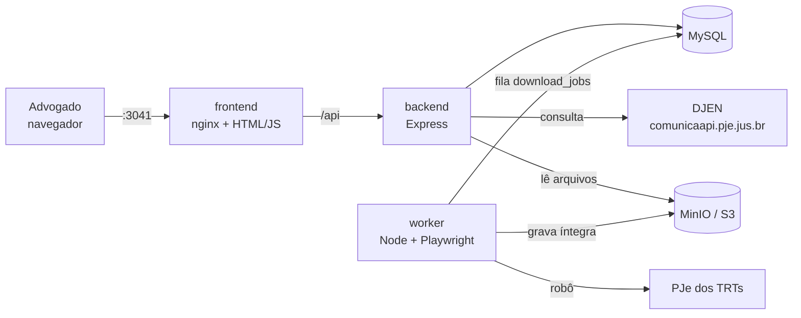

# Arquitetura

## Serviços (docker-compose)

| Serviço | Imagem | Papel |
|---|---|---|
| `frontend` | nginx 1.27 | Serve `frontend/public` e faz proxy de `/api` → `backend:3041`. Única porta pública da aplicação (**3041**). |
| `backend` | node 22 alpine | Autenticação JWT, identificação do tribunal, consulta ao DJEN, criação de jobs, streaming dos documentos. |
| `worker` | node 22 bookworm + Chromium | Consome `download_jobs`, roda o adapter do tribunal, envia arquivos ao S3, vincula ao usuário. |
| `mysql` | mysql 8.4 | Banco. Schema em `database/init.sql`. |
| `minio` | build local (fonte oficial) | S3 local. Ver [armazenamento.md](armazenamento.md). |

## Fluxo principal

1. **Login**: `POST /api/auth/login` → JWT (12 h por padrão), guardado no `localStorage`.
2. **Consulta**: o usuário digita o número. O front já mostra o tribunal identificado (`GET /api/tribunais/identificar/:numero`, só usa o mapa local, sem chamada externa).
3. **Overview**: `POST /api/processos/consultar` → valida o número (DV mod 97), identifica tribunal, consulta o DJEN, monta o overview (classe, órgão, partes, advogados, linha do tempo), salva a consulta. Se o DJEN cair, devolve a última consulta salva (cache) com aviso.
4. **Download (opcional)**: `POST /api/processos/:numero/download` → cria job `pendente` (idempotente: se já existe um ativo para o mesmo usuário/processo, devolve ele). Só libera para segmentos em `DOWNLOAD_SEGMENTOS_HABILITADOS` (padrão `5`).
5. **Worker**: reserva o job (`FOR UPDATE SKIP LOCKED`), roda o adapter, envia ao S3, grava `documentos`, cria/atualiza `usuarios_processos` e marca `concluido`. O front faz polling em `GET /api/downloads/:id`.
6. **Meus processos**: `GET /api/processos` lista o que o usuário já baixou; `GET /api/documentos/:id/download` faz o streaming do PDF.

## Decisões

**Worker separado do frontend (`/worker` na raiz).** O front é estático e leve; o worker é um processo longo com navegador headless (~1 GB de imagem, consome CPU/RAM). Separado ele escala sozinho (`--scale worker=N`), cai sem derrubar a interface e pode rodar em outra máquina no futuro.

**Fila no próprio MySQL (sem Redis/RabbitMQ).** O volume é baixo (downloads sob demanda de advogado), e `SELECT ... FOR UPDATE SKIP LOCKED` do MySQL 8 garante que cada job vá para um único worker. Um componente a menos para operar. Se o volume crescer, a interface do `fila.service.js` é pequena o bastante para trocar por SQS/Redis.

**Heartbeat + retries.** O worker atualiza `heartbeat_em` a cada 15 s. Job com heartbeat parado há mais de `WORKER_HEARTBEAT_EXPIRA_S` (120 s) volta para a fila (worker morreu). Erros temporários re-tentam com backoff exponencial (30 s, 60 s, 120 s...) até `max_tentativas` (3); erros definitivos (processo inexistente, adapter não implementado) encerram direto.

**Processo compartilhado, vínculo por usuário.** `processos` tem um registro por número CNJ; `usuarios_processos` liga quem baixou. Cada download gera uma "versão" nova no S3 (pasta por job), sem sobrescrever a anterior.

**Backend faz streaming dos arquivos** em vez de devolver URL pré-assinada: o endpoint interno do MinIO (`minio:9000`) não é acessível pelo navegador e assim o controle de acesso fica todo na API. Na AWS dá para trocar por URL pré-assinada.

**`shared/`** guarda o que backend e worker precisam igual (parser CNJ e mapa de tribunais). Por isso os Dockerfiles do backend e do worker usam a raiz do repo como contexto de build.
