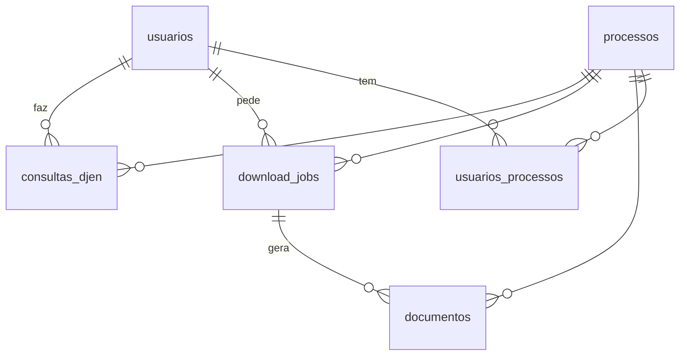
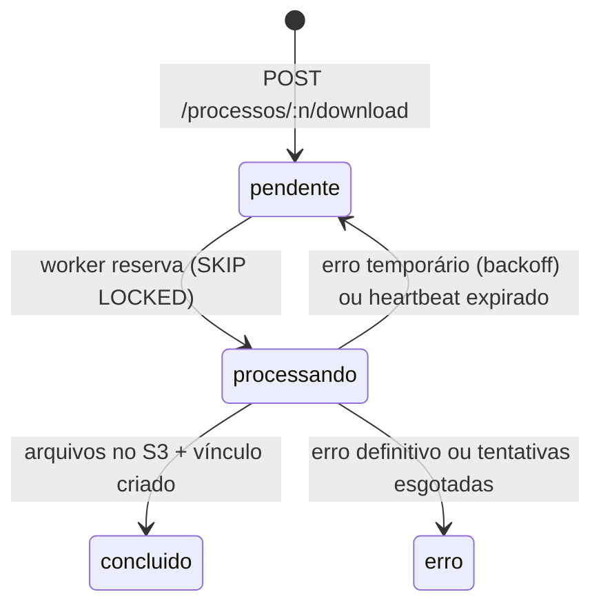

# Banco de dados

MySQL 8.4, banco `tr_api`, `utf8mb4`, tudo em **UTC**.

## Regra de ouro

`database/init.sql` contém o **estado atual e completo** do schema + dados iniciais. Não existem migrations separadas.

Ao alterar o schema:
1. Edite o `init.sql` (tabelas/colunas/índices como devem ficar).
2. Acrescente uma linha nova em `INSERT INTO schema_info` com a versão nova (ex.: `0.2.0`).
3. Atualize `schemaVersaoEsperada` em `backend/config/index.js`.
4. Rode `make reset`.

O MySQL só executa scripts de `docker-entrypoint-initdb.d` com o volume **vazio**. Por isso o backend compara a versão em `schema_info` com a esperada e escreve um aviso no log se estiverem diferentes.

> Quando houver dados de produção que não podem ser apagados, aí sim vale introduzir uma ferramenta de migration. Até lá, o init.sql único é mais simples.

## Tabelas

| Tabela | Para quê |
|---|---|
| `schema_info` | Versão do schema aplicada. |
| `usuarios` | Login (bcrypt), perfil `admin`/`usuario`, `ativo`. |
| `processos` | Um registro por número CNJ (20 dígitos): campos J/TR/OOOO decompostos, sigla do tribunal, última classe/órgão vistos no DJEN. |
| `consultas_djen` | Histórico de consultas: overview processado + resposta crua. A última com sucesso serve de cache quando o DJEN falha. |
| `download_jobs` | Fila do worker: status, tentativas, backoff (`proxima_tentativa_em`), `heartbeat_em`, erro, adapter usado. |
| `documentos` | Arquivos no S3 (bucket, chave, tamanho, sha256), ligados ao job que os gerou. |
| `usuarios_processos` | "Meus processos": quem baixou o quê, apontando para o último job. Criado pelo worker ao concluir. |

## Ciclo de vida de um job

## Acesso

- Do seu PC: `localhost:3307`, usuário `tr_api`, senha `tr_api_dev`.
- Pelo container: `make mysql`.
